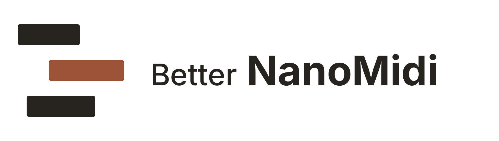

# Better NanoMidi

<p align="center">
  <picture>
    <source media="(prefers-color-scheme: dark)" srcset="assets/branding/better-nanomidi/logo-horizontal-on-dark.png">
    
  </picture>
</p>

<p align="center">
  <strong>More music, less friction.</strong><br>
  A modern desktop home for your MIDI library, playlists, and playback.
</p>

<p align="center">
  <a href="https://github.com/FelipeStrike01/BetterNanoMidi/actions/workflows/build.yml"></a>
  
  
  
</p>

<p align="center">
  <a href="#features">Features</a> ·
  <a href="#run-from-source">Quick start</a> ·
  <a href="#build">Build</a> ·
  <a href="#project-structure">Project structure</a> ·
  <a href="#credits-and-license">Credits</a> ·
  <a href="README.pt.md">Português</a>
</p>

Better NanoMidi is an independent fork of [nanoMIDIPlayer](https://github.com/NotHammer043/nanoMIDIPlayer). It keeps the original MIDI playback engine and adds a PySide6 and Qt Quick interface, a local MIDI library, broader catalog search, and optional Discord Rich Presence.

## Features

- Play MIDI files through QWERTY input or a selected MIDI output device.
- Map incoming MIDI devices to QWERTY keys.
- Play drum tracks with configurable keyboard mappings.
- Browse local MIDI files and search the community catalog, with BitMidi as a fallback.
- Build ordered MIDI playlists and move to the next track automatically when one ends.
- Configure sustain, velocity, pitch, speed, keyboard range, and hotkeys.
- Use the interface in English or Portuguese, with optional Discord Rich Presence.
- Run on Windows, macOS, and Linux; available input and MIDI features depend on the operating system and installed devices.

The app keeps its configuration and downloaded MIDI files under `Documents/nanoMIDIPlayer` to preserve compatibility with existing installations.

## Run from source

Use Python 3.12 and install the pinned dependencies:

```powershell
python -m venv .venv
.venv\Scripts\activate
python -m pip install -r requirements.txt
python main.py
```

On macOS or Linux, activate the environment with `source .venv/bin/activate` before running the last two commands.

## Build

Run the build script for the current platform:

```powershell
scripts\build-win.bat
```

```bash
./scripts/build-mac.sh --arch arm
./scripts/build-mac.sh --arch intel
./scripts/build-lnx.sh
```

The Windows build produces `dist/Better NanoMid.exe`. macOS and Linux builds use the `BetterNanoMidi` name. GitHub Actions builds all four targets on pushes, pull requests, and manual runs; download the artifacts from the workflow run.

Automatic update checks are disabled until Better NanoMidi has its own release repository. They will not download binaries from the original project.

## Project structure

| Path | Contents |
|---|---|
| `ui/qml/` | Qt Quick interface and reusable components |
| `ui/controller.py` | Python and QML application bridge |
| `modules/` | MIDI playback, input, configuration, and services |
| `assets/` | App defaults, branding, fonts, and About content |
| `api/` | Default data and the optional update bootstrapper source |
| `scripts/` | Platform build scripts and shader compilation |
| `build-portable/` | Windows PyInstaller spec and Qt collection hooks |

## Credits and license

Better NanoMidi builds on the work of **NotHammer043 (NotHammer)** and contributors to the original nanoMIDIPlayer project. This is an independent fork and is not an official release of that project.

The project is distributed under **GNU GPL v3**. See [`LICENSE`](LICENSE) and [`THIRD_PARTY_NOTICES.md`](THIRD_PARTY_NOTICES.md) for license details.
